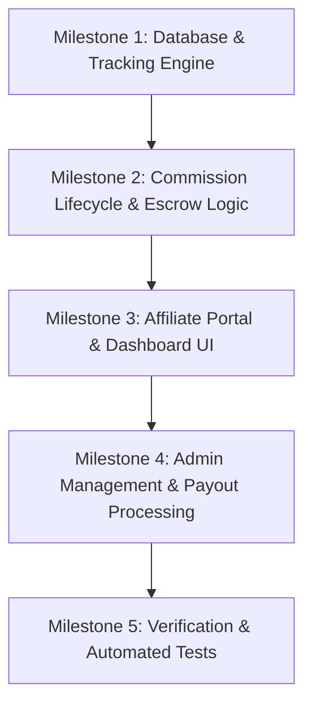

# BookTala 5% Affiliate Marketing Program & Partner Portal
## Comprehensive Architectural Implementation Plan

**Platform:** BookTala Luxury Stays & Shortlets  
**Parent Brand:** G-Briel Property Ltd  
**Commission Model:** Model 1 — Flat 5% on Net Accommodation Revenue  
**Date:** November 20, 2026  
**Status:** Architecture & Implementation Blueprint  

---

## 1. Executive Summary & Business Economics

### 1.1 The Core Value Proposition
Every reservation captured through Airbnb or Booking.com costs BookTala **15% to 18% in host commission fees**, while keeping customer contact details shielded.

By launching BookTala’s direct **5% Affiliate Program**:
1. **Net Savings:** BookTala retains **10% to 13% more revenue** on every referred stay compared to an OTA booking.
2. **First-Party Data Ownership:** The referred guest registers directly on BookTala, giving you their verified email, phone number, and booking preferences for lifetime repeat bookings with **0% commission**.
3. **Decentralized Sales Force:** Transforms local realtors, corporate travel coordinators, wedding/event planners, and Lagos lifestyle influencers into commissioned sales ambassadors who actively pitch BookTala over competing shortlets.

```
OTA Booking (Airbnb/Booking.com):
[Guest Pays ₦500,000] ──> [OTA Takes 15% (₦75,000)] ──> [BookTala Keeps ₦425,000]

BookTala Affiliate Booking:
[Guest Pays ₦500,000] ──> [Affiliate Earns 5% (₦25,000)] ──> [BookTala Keeps ₦475,000]
                                                  ▲
                             Net Gain to BookTala: +₦50,000 (+11.7% profit)
```

---

## 2. Business & Anti-Fraud Guardrails (The 5 Golden Rules)

To protect BookTala's financial margins and eliminate gaming or fraud, the system will enforce five strict architectural rules:

### Rule 1: Commission Base = Net Room Revenue Only
* **Included:** `price_per_night × number_of_nights` (post any applied discounts).
* **Strictly Excluded:**
  - Refundable Caution / Security Deposit (e.g. ₦20,000–₦50,000).
  - Online Card Processing / Gateway Fees.
  - Value Added Tax (VAT) / Consumption Tax.
  - On-demand add-ons (airport pickup, private chef, room service).
* **Formula:**
  $$\text{Commission} = 5\% \times (\text{Gross Accommodation} - \text{Discounts})$$

### Rule 2: Post-Checkout Escrow Maturation (Anti-Cancellation Lock)
* When a referred booking is paid, the commission is recorded in **`pending`** status.
* The funds **cannot be withdrawn immediately**.
* Commission status transitions to **`approved` (matured)** strictly **24 hours post-checkout**, after front-desk confirms that the guest actually stayed and no cancellation or chargeback took place.
* If a booking is canceled or refunded, the commission is automatically set to **`void`**.

### Rule 3: Self-Referral Prevention
* An affiliate cannot earn commission on their own bookings.
* Automated fraud detection checks for:
  - Matching User ID between affiliate and booking guest.
  - Matching email address or phone number.
  - Matching bank account holder name or IP address during checkout.

### Rule 4: 30-Day Attribution Window (First-Click or Last-Click)
* When a visitor clicks an affiliate tracking link (`booktala.com?ref=CODE`), an encrypted cookie (`bt_affiliate`) is stored in the visitor’s browser for **30 days**.
* If the user books any apartment within 30 days, the affiliate receives credit.
* Optionally, affiliates are issued a **Custom Vanity Promo Code** (e.g. `LEKKIVIP`) so bookings made across devices without cookies are still tracked 100%.

### Rule 5: KYC Verification & Minimum Withdrawal Threshold
* **Minimum Payout:** ₦20,000 accumulated balance before requesting a withdrawal.
* **Banking KYC:** Nigerian NUBAN bank account verification via Paystack Bank Account Lookup to ensure the affiliate’s legal name matches their bank details before any disbursement.

---

## 3. Data Architecture & Schema Design

### 3.1 Migration: `create_affiliates_table`
```sql
CREATE TABLE affiliates (
    id BIGINT UNSIGNED AUTO_INCREMENT PRIMARY KEY,
    user_id BIGINT UNSIGNED NOT NULL UNIQUE,
    code VARCHAR(32) NOT NULL UNIQUE,          -- e.g. "LEKKIVIP", "BABATUNDE"
    commission_rate DECIMAL(5,2) DEFAULT 5.00,  -- 5.00%
    bank_code VARCHAR(10) NULL,
    bank_name VARCHAR(100) NULL,
    account_number VARCHAR(20) NULL,
    account_name VARCHAR(150) NULL,
    recipient_code VARCHAR(100) NULL,          -- Paystack Transfer Recipient
    status ENUM('pending', 'active', 'suspended') DEFAULT 'active',
    lifetime_earnings DECIMAL(12,2) DEFAULT 0.00,
    current_balance DECIMAL(12,2) DEFAULT 0.00,
    created_at TIMESTAMP NULL,
    updated_at TIMESTAMP NULL,
    FOREIGN KEY (user_id) REFERENCES users(id) ON DELETE CASCADE
);
```

### 3.2 Migration: `create_affiliate_referrals_table`
```sql
CREATE TABLE affiliate_referrals (
    id BIGINT UNSIGNED AUTO_INCREMENT PRIMARY KEY,
    affiliate_id BIGINT UNSIGNED NOT NULL,
    reservation_id BIGINT UNSIGNED NOT NULL UNIQUE,
    guest_user_id BIGINT UNSIGNED NOT NULL,
    base_accommodation_amount DECIMAL(12,2) NOT NULL,
    commission_rate DECIMAL(5,2) NOT NULL DEFAULT 5.00,
    commission_amount DECIMAL(12,2) NOT NULL,
    status ENUM('pending', 'approved', 'paid', 'void') DEFAULT 'pending',
    check_in DATE NOT NULL,
    check_out DATE NOT NULL,
    matured_at TIMESTAMP NULL,                 -- check_out + 24 hours
    created_at TIMESTAMP NULL,
    updated_at TIMESTAMP NULL,
    FOREIGN KEY (affiliate_id) REFERENCES affiliates(id) ON DELETE CASCADE,
    FOREIGN KEY (reservation_id) REFERENCES reservations(id) ON DELETE CASCADE
);
```

### 3.3 Migration: `create_affiliate_payouts_table`
```sql
CREATE TABLE affiliate_payouts (
    id BIGINT UNSIGNED AUTO_INCREMENT PRIMARY KEY,
    affiliate_id BIGINT UNSIGNED NOT NULL,
    payout_ref VARCHAR(50) NOT NULL UNIQUE,
    amount DECIMAL(12,2) NOT NULL,
    bank_name VARCHAR(100) NOT NULL,
    account_number VARCHAR(20) NOT NULL,
    account_name VARCHAR(150) NOT NULL,
    status ENUM('requested', 'processing', 'completed', 'failed') DEFAULT 'requested',
    transfer_reference VARCHAR(100) NULL,
    processed_by BIGINT UNSIGNED NULL,
    paid_at TIMESTAMP NULL,
    notes TEXT NULL,
    created_at TIMESTAMP NULL,
    updated_at TIMESTAMP NULL,
    FOREIGN KEY (affiliate_id) REFERENCES affiliates(id) ON DELETE CASCADE
);
```

---

## 4. Affiliate Portal UI & Experience (`/affiliate`)

The affiliate experience will be housed under clean, dedicated routes styled with BookTala's luxury brand theme (`#0B2D5B` navy and `#E11D2E` ruby accent):

### 4.1 Onboarding & Registration (`/affiliate/join`)
* Seamless one-click onboarding for registered users or a dedicated registration form for external partners.
* Affiliates choose their unique referral slug (e.g. `booktala.com?ref=KEMI` or `booktala.com/apartments?ref=KEMI`).
* Instant generation of personal referral links, QR codes, and custom promo code.

### 4.2 Partner Dashboard (`/affiliate/dashboard`)
* **Key KPI Metric Cards:**
  1. **Total Earnings (Lifetime):** Total Naira earned to date.
  2. **Available Balance:** Matured commissions eligible for immediate withdrawal.
  3. **Pending Balance:** Commissions held in escrow awaiting guest check-out.
  4. **Total Referrals:** Count of completed guest reservations.
  5. **Click-Throughs & Conversion:** Visits generated vs. bookings confirmed.
* **Instant Link Generator:** Affiliates can input any specific apartment URL (e.g. `/apartments/signature-3-bedroom-ikoyi-suite`) and generate an immediate tracked link with copy-to-clipboard.
* **Referrals Ledger Table:**
  - Date booked, stay dates, apartment name, guest initials (privacy protected), accommodation value, commission earned, and status badge (`Pending Stay`, `Matured`, `Paid`, `Cancelled`).
* **Payout & Banking Center:**
  - Add/Update Nigerian Bank Details (with live Paystack bank name validation).
  - One-click **"Request Payout"** button when available balance exceeds ₦20,000.
  - Transparent payout audit log with date, amount, transfer reference, and receipt download.

### 4.3 Marketing Assets & Partner Resource Kit (`/affiliate/marketing`)
* **High-Res Photography Packs:** Downloadable ZIP archives of verified BookTala apartments for WhatsApp status and Instagram stories.
* **Ready-Made Copywriting Templates:** Pre-written WhatsApp pitches, email copy, and social media captions tailored for:
  - Diaspora travelers visiting Lagos for holidays / Detty December.
  - Corporate business travelers seeking serviced Lekki/VI stays.
  - Wedding and event guest lodging.
* **Promotional Banners:** Standard web banners (300x250, 728x90, 1080x1080) with affiliate link parameters embedded.

---

## 5. Admin Management Portal (`/admin/affiliates`)

Super Admins and Admins will have full visibility and governance in the admin dashboard:

1. **Affiliate Roster (`/admin/affiliates`):**
   - List of all active affiliates, their referral counts, lifetime volume, and balance.
   - Ability to approve, suspend, or customize an individual affiliate's commission rate (e.g., bump high-volume partners to 7%).
2. **Referral Transactions Audit (`/admin/affiliates/referrals`):**
   - Searchable log of every single referred booking, showing exact reservation IDs, dates, and calculated 5% payouts.
3. **Payout Approval Queue (`/admin/affiliates/payouts`):**
   - Review pending withdrawal requests.
   - One-click approval via Paystack Transfer API or mark as manually wired with transaction reference.

---

## 6. Marketing & Partner Acquisition Playbook

To drive rapid adoption upon launch, BookTala can activate three high-yield channels in Lagos:

### Channel 1: Lagos Real Estate Agents & Realtors
* **The Pitch:** *"You show clients ₦50M+ properties. When clients visit from abroad or are between leases, earn 5% on their shortlet stay instead of giving it away to Airbnb for free."*
* **Incentive:** On a typical ₦1,200,000 two-week diaspora stay, the realtor makes ₦60,000 cash for just sending their link.

### Channel 2: Event & Wedding Planners
* **The Pitch:** *"Book your bridal parties and overseas wedding guests into luxury BookTala residences with 24/7 power and concierge. We handle the hospitality; you earn 5% on the entire accommodation package."*

### Channel 3: Lifestyle & Travel Creators
* **The Pitch:** *"Include your BookTala link in your YouTube apartment tours, TikTok reviews, and Instagram bios. Your followers get verified luxury stays with guaranteed 24/7 power, and you earn 5% on every booking."*

---

## 7. Implementation Roadmap & Technical Milestones



| Milestone | Deliverables | Key Components |
| :--- | :--- | :--- |
| **Milestone 1: Schema & Tracking** | • Migrations for affiliates, referrals, payouts<br>• Cookie attribution middleware (`bt_affiliate`)<br>• Booking attribution on checkout completion | `app/Http/Middleware/TrackAffiliateReferral.php`<br>`app/Models/Affiliate.php` |
| **Milestone 2: Lifecycle Engine** | • 5% Net calculation logic<br>• Hold/escrow maturation command (`affiliates:mature-commissions`)<br>• Cancellation/refund automatic voiding | `app/Services/AffiliateCommissionService.php`<br>`routes/console.php` cron |
| **Milestone 3: Affiliate Portal** | • Registration / Join page<br>• Dashboard metrics & link generator<br>• Referral history ledger<br>• Marketing resource center | `resources/views/affiliate/`<br>`app/Http/Controllers/Affiliate/` |
| **Milestone 4: Admin Governance** | • Affiliate roster & rate controls<br>• Payout queue approval<br>• Bank transfer processing | `resources/views/admin/affiliates/`<br>`app/Http/Controllers/Admin/AffiliateController.php` |
| **Milestone 5: Verification** | • Unit & Feature tests for tracking, calculations, anti-fraud, payouts<br>• Zero regressions across existing test suite | `tests/Feature/AffiliateSystemTest.php` |
