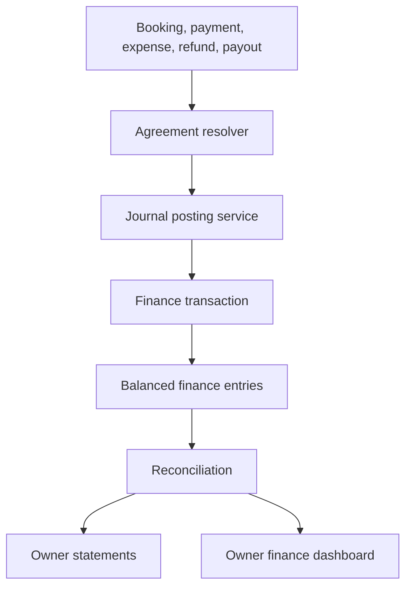
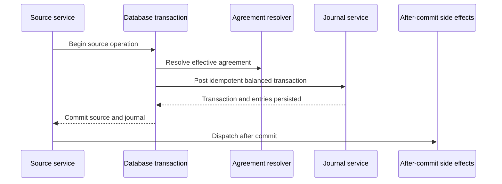
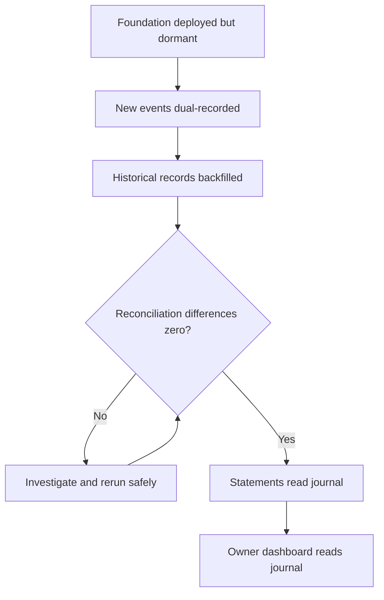

# Property Finance Ledger - Plan

## Goal Capsule

- **Objective:** BookTala staff and property owners can trace each property's collected income, fees, liabilities, expenses, owner entitlement, and payouts without one property's records affecting another.
- **Means:** Add effective-dated management agreements and an immutable, balanced operational journal, then move statements and owner reporting to that journal in controlled stages (KTD1-KTD10).
- **Authority:** The Product Contract owns financial behavior. The Planning Contract owns implementation mechanics. Existing reservation, payment, and authorization behavior remains authoritative where this plan does not change it.
- **Execution profile:** Deliver as three dependent pull requests because each later stage requires the earlier schema and production data checks to be deployed first.
- **Stop conditions:** Do not switch statement or dashboard reads to the journal until the historical backfill reconciles. Do not approve an external-owner statement for a period without agreement coverage.
- **Completion owner:** The implementing agent completes the units, verification, rollout evidence, and deployment notes for each pull request.

---

## Product Contract

### Summary

BookTala will keep its current booking and collection flows while adding a property-attributed operational subledger. Management terms will be attached to units for defined effective periods. Every financial event will produce balanced entries that preserve the owner, property, unit, reservation, agreement, and source event that applied when the event occurred.

### Problem Frame

Current owner statements calculate revenue and expenses from mutable reservations, expenses, and owner-level commission settings. Those records do not preserve the terms that applied to a past stay, distinguish collected cash from earned accommodation revenue, or provide a durable audit trail for refunds, caution liabilities, and payouts. The existing design also makes property-level finance and owner self-service difficult to reconcile as BookTala adds third-party properties.

### Key Decisions

- **Keep an operational subledger rather than build a general accounting system.** BookTala needs traceable property operations, not a replacement for statutory accounting software. Governs R1-R14.
- **Attribute financial history to the unit and agreement effective at posting time.** Later ownership or agreement edits must not rewrite prior periods. Governs R3, R4, R8, R10, R13.
- **Treat the processing fee as BookTala income and caution money as a liability until resolved.** These amounts must not inflate accommodation or owner revenue. Governs R5-R7.
- **Migrate incrementally.** New tables and writers ship before historical backfill and read cutover. Governs R11-R14.

### Requirements

**Agreement and attribution**

- R1. Each externally managed unit has an effective-dated management agreement that records its owner, commission terms, expense treatment, and review state.
- R2. Agreement effective periods for one unit cannot overlap.
- R3. A financial entry keeps the owner, site, unit, reservation, and agreement attribution that applied when it was posted.
- R4. Editing unit ownership or agreement terms affects future postings only.

**Financial classification**

- R5. The ₦2,000 processing fee is BookTala fee income attributed to the booking's site and unit.
- R6. The ₦20,000 caution fee is a liability until it is refunded or forfeited.
- R7. Accommodation, VAT, processing fees, caution liabilities, commissions, expenses, refunds, owner payables, and payouts remain separately reportable categories.
- R8. Collected cash and earned accommodation revenue are separate events; accommodation becomes statement-eligible only under the completed-stay rule.

**Journal integrity**

- R9. Each financial event posts one balanced transaction whose entries sum to zero in one currency.
- R10. Posted transactions and entries are immutable; corrections use a linked reversal and replacement transaction.
- R11. Repeating the same source event does not create duplicate financial transactions.
- R12. Source-state changes and their journal transaction commit atomically, while notifications and other queued side effects start after commit.

**Statements, payouts, and isolation**

- R13. Owner statements use journal entries for fully paid completed stays and eligible expenses, freeze when approved, and retain their payout reference when paid.
- R14. Staff finance views respect site access, and an owner can view only entries, statements, and units owned during the relevant period.

### Actors

- A1. Front-desk and finance staff record bookings, collections, expenses, refunds, caution outcomes, and payouts within their authorized sites.
- A2. Finance managers review agreements, reconcile the ledger, approve statements, and record payouts.
- A3. Property owners monitor collected income, deductions, estimated entitlement, approved statements, and payout status for their own units.
- A4. Payment providers may deliver the same webhook more than once and out of order.

### Key Flows

- F1. Booking collection
  - **Trigger:** A payment or verified offline collection is recorded.
  - **Actors:** A1, A4
  - **Steps:** Resolve the unit agreement, update the source record, post one idempotent balanced collection transaction, then start after-commit side effects.
  - **Outcome:** Cash collection, deferred accommodation, VAT, processing income, and caution liability are traceable without duplication.
  - **Covered by:** R1, R3, R5-R7, R9, R11, R12
- F2. Stay completion
  - **Trigger:** A paid reservation reaches the completed checkout state.
  - **Actors:** A1
  - **Steps:** Recognize accommodation revenue, commission, and owner payable under the captured agreement.
  - **Outcome:** The stay becomes eligible for the correct owner's statement.
  - **Covered by:** R3, R4, R8-R12
- F3. Refund or caution resolution
  - **Trigger:** Staff refund a charge or resolve caution money as refunded or forfeited.
  - **Actors:** A1, A2
  - **Steps:** Post a source-linked transaction that clears the prior liability or reverses the affected category.
  - **Outcome:** The audit trail retains both the original and corrective events.
  - **Covered by:** R6, R7, R9-R12
- F4. Statement and payout
  - **Trigger:** A finance manager closes an owner period.
  - **Actors:** A2, A3
  - **Steps:** Verify agreement coverage, generate from eligible journal entries, approve the frozen statement, post payout, and expose the status to the owner.
  - **Outcome:** The statement reconciles to ledger entries and the payout reference remains visible.
  - **Covered by:** R1, R7, R13, R14

### Acceptance Examples

- AE1. **Covers R5-R7, R9.** Given a booking with accommodation, VAT, a ₦2,000 processing fee, and a ₦20,000 caution fee, when payment is collected, then the balanced journal reports each category separately and does not treat caution money as revenue.
- AE2. **Covers R2, R4.** Given an agreement effective through 31 December and a new agreement starting 1 January, when a December stay and January stay are recognized, then each stay retains the terms from its own effective period.
- AE3. **Covers R10, R11.** Given the same successful provider webhook is delivered twice, when both requests finish, then one source transaction exists; a later refund adds linked corrective entries without editing that transaction.
- AE4. **Covers R12.** Given journal posting fails during a payment update, when the database transaction rolls back, then neither the source payment state nor partial journal entries persist.
- AE5. **Covers R13, R14.** Given one owner has units at two sites and another owner has a unit at one of those sites, when the first owner opens the portal, then only the first owner's attributed entries and statements appear, separated by property.
- AE6. **Covers R1, R13.** Given an external-owner statement period has an uncovered agreement date, when finance attempts approval, then approval is blocked with the uncovered unit and dates identified.

### Success Criteria

- Every posted journal transaction balances to exactly zero and has one unique idempotency key.
- Historical backfill totals reconcile by property and category before journal-backed reports are enabled.
- Existing booking, payment, walk-in, checkout, and statement tests remain green throughout the staged rollout.
- Owner-visible totals can be traced from a statement line to journal entries and their source records.

### Scope Boundaries

**Included**

- Effective-dated management agreements at unit level.
- Double-entry operational journal, source posting, reversal, reconciliation, statements, payouts, and owner finance monitoring.
- Site and owner authorization for every new finance read and write path.

**Deferred to Follow-Up Work**

- Tax filing, statutory general ledger export, bank-feed reconciliation, and automated owner bank transfers.
- Multi-currency accounting and foreign-exchange gains or losses.
- Budgeting, procurement approvals, payroll accounting, and full chart-of-accounts administration.

**Considered and not built**

- Database-specific immutable triggers are not included because the application supports SQLite in development and MySQL in production; service boundaries, model guards, authorization, and reconciliation provide portable enforcement. Reconsider if external writers gain direct database access.
- Eventual-consistency posting is not included because a successful payment without its journal record creates financial harm that reconciliation would find too late.

---

## Planning Contract

### Key Technical Decisions

- KTD1. **Use effective-dated unit agreements.** A resolver selects the reviewed agreement whose date range covers the supplied economic date. Agreement creation and review lock the canonical unit row before checking overlap, so concurrent inserts for an empty date range cannot both pass. This implements R1-R4.
- KTD2. **Use a balanced transaction-and-entry journal with integer minor units.** One transaction records source identity and lifecycle; signed integer kobo amounts record account category and dimensional attribution. The posting service rejects a non-zero total before persistence and formats Naira only at system boundaries. This implements R3 and R7-R10.
- KTD3. **Make the idempotency key a database unique constraint.** Provider retries and concurrent requests must converge even when application-level checks race. Each transaction stores a canonical payload hash; the posting service returns the prior result only when both key and hash match and rejects conflicting reuse. This implements R11.
- KTD4. **Store attribution snapshots on entries.** Foreign keys support navigation, while captured identifiers and agreement references preserve historical reporting when current ownership changes. This implements R3, R4, and R14.
- KTD5. **Post source changes and journal entries in the same database transaction.** The service retries deadlocks within a bounded attempt count. Notifications and queued listeners use explicit after-commit dispatch because the current queue connections set `after_commit` to false. This implements R12.
- KTD6. **Model corrections as reversals.** A reversal transaction copies the original dimensions with opposite signed amounts and links to the original; a replacement is a separate idempotent transaction. This implements R10.
- KTD7. **Backfill through the same posting contracts with a dedicated namespace.** Reconciliation compares source totals and journal totals per property, category, and period before any read cutover. This implements R11 and R13.
- KTD8. **Cut reads over only after deployed reconciliation.** New writers may run while existing statements remain authoritative. Statements and owner dashboards switch only after the earlier production backfill passes and unresolved differences are zero. This implements R13 and R14.
- KTD9. **Resolve agreements by the source event's economic date.** Reservation collections, recognition, refunds, and caution outcomes use the reservation check-in date so one booking keeps one agreement; expenses use the expense date; statements and payouts retain the agreements already captured by their included entries. This implements R3, R4, and R13.
- KTD10. **Allocate partial collections deterministically.** A collection first settles the non-refundable processing fee, then accommodation and VAT proportionally, and settles caution last. This preserves the current rule that caution becomes held only when the reservation is fully paid and prevents repeated partial payments from recognizing a fee twice. This implements R5-R8 and R11.

### Posting Contracts

The posting layer owns these balanced operational movements. The labels are stable journal categories, not a configurable general ledger.

| Event | Positive entries | Negative entries | Agreement/economic date |
|---|---|---|---|
| Collection | Cash or provider clearing | Processing fee income, deferred accommodation, VAT payable, caution liability according to KTD10 | Reservation check-in |
| Stay completion | Earned accommodation, owner expense recovery when applicable | Deferred accommodation, commission income, owner payable | Reservation check-in |
| Charge refund | Reversal of the refunded collected categories | Cash or provider clearing | Original transaction attribution |
| Caution refund | Caution liability | Cash or provider clearing | Original transaction attribution |
| Caution forfeiture | Caution liability | Company income or owner payable under the captured agreement | Reservation check-in |
| Property expense | Company expense or owner-recoverable expense | Cash or expense payable | Expense date |
| Owner payout | Owner payable | Cash or payout clearing | Statement's captured entries |

### High-Level Technical Design

The journal becomes the financial reporting source in stages while reservations, payments, and expenses remain operational source records.



Each event follows one atomic posting protocol.



The rollout keeps every deployed state usable.



### Output Structure

```text
app/
  Models/
    FinanceEntry.php
    FinanceTransaction.php
    ManagementAgreement.php
  Services/Finance/
    AgreementResolver.php
    JournalService.php
    LedgerPostingService.php
    LedgerReconciliationService.php
database/
  migrations/
  seeders/
tests/
  Feature/Finance/
  Unit/Finance/
```

### System-Wide Impact

- **Data lifecycle:** Financial corrections become append-only. Agreement and ownership changes no longer alter historical calculations.
- **Authorization:** All ledger queries require existing property-access scoping plus owner-period attribution. Aggregate queries cannot start from an unscoped finance table.
- **Transactions and queues:** Payment, offline collection, checkout, expense, refund, and payout services become journal callers. Their user notifications must start after commit.
- **Reporting:** Existing owner statements and finance reports continue reading current sources until reconciliation allows cutover. Report totals must then use one journal-backed query layer.
- **Operations:** Deployment requires agreement coverage reports, idempotent backfill commands, reconciliation output, and a documented rollback that disables new reads without deleting journal history.

### Risks and Dependencies

- Historical records may lack a reliable unit or agreement. The backfill records unresolved rows and blocks cutover instead of assigning them silently.
- SQLite and MySQL differ in locking behavior. Concurrency tests cover the service contract, and the production rollout verifies unique-key and range-resolution behavior on MySQL.
- Existing reports use inconsistent payment-status filters. Journal cutover removes those independent calculations only after parity totals are captured.
- Current owner-level commission fields remain as temporary defaults during agreement migration. They are not removed until all external units have reviewed agreements and no reader depends on them.
- The existing reservation lifecycle and payment webhook idempotency remain dependencies; journal idempotency supplements rather than replaces their source-level guards.

### Sources

- `docs/plans/2026-11-18-1042-feat-property-management-foundation-plan.md` defines the property-management product decisions and original finance requirements.
- `app/Services/OwnerStatementService.php` shows current mutable source-based statement calculation.
- `app/Services/PaymentService.php`, `app/Services/WalkInBookingService.php`, and `app/Services/ReservationLifecycle.php` define current transactional integration points.
- `database/migrations/2026_11_19_000001_create_finance_and_payroll_tables.php` defines current owner statements, expenses, and owner-level terms.
- `config/queue.php` sets queue `after_commit` to false, which requires explicit after-commit handling for finance side effects.
- [Laravel database transactions](https://laravel.com/framework/docs/database/config) documents automatic rollback and bounded deadlock retries.
- [Laravel queues](https://laravel.com/framework/docs/13.x/queues) and [Laravel notifications](https://laravel.com/framework/docs/13.x/notifications) document after-commit dispatch behavior.
- [MySQL InnoDB transaction model](https://dev.mysql.com/doc/refman/8.4/en/innodb-transaction-model.html) and [isolation levels](https://dev.mysql.com/doc/refman/8.4/en/innodb-transaction-isolation-levels.html) inform unique-key and locking decisions.

---

## Implementation Units

### PR1: Agreement and journal foundation

Waits on: nothing.

This pull request is safe to deploy before any writer uses the new tables. It establishes the persistent contracts that later pull requests need in production.

### U1. Effective-dated management agreements

- **Goal:** Store reviewed unit agreements and resolve the agreement that applies on a given date without overlapping effective periods.
- **Requirements:** R1-R4, AE2, AE6
- **Dependencies:** None
- **Files:** `database/migrations/2026_11_24_000001_create_management_agreements_and_finance_ledger.php`, `app/Models/ManagementAgreement.php`, `app/Models/Unit.php`, `app/Models/Owner.php`, `app/Services/Finance/AgreementResolver.php`, `tests/Feature/Finance/ManagementAgreementTest.php`
- **Approach:**
  1. Add agreement dates, owner and unit references, commercial terms, review metadata, and indexes after the migrations that created canonical units and existing finance tables.
  2. Add model relationships and casts without removing current owner-level defaults.
  3. Lock the canonical unit row while creating or reviewing an agreement, then reject overlapping ranges and invalid end-before-start ranges.
  4. Resolve reviewed agreements from the economic date supplied under KTD9 when the caller is posting money.
- **Patterns to follow:** Existing model casts and relationship conventions in `app/Models`; transactional validation in `app/Services/WalkInBookingService.php`.
- **Execution note:** Implement the range and resolver behavior test-first.
- **Test scenarios:**
  - Covers AE2. Two adjacent agreements resolve to the old terms on 31 December and the new terms on 1 January.
  - Creating an agreement whose dates intersect an existing range for the same unit is rejected and leaves both records unchanged.
  - Agreements for different units may use the same dates.
  - A draft agreement does not resolve for posting; a reviewed agreement does.
  - Resolving an uncovered external unit date returns a domain failure that identifies the unit and date.
- **Verification:** Agreement tests prove date boundaries, overlap rejection, review gating, and unit isolation on SQLite; migration order works on an empty database.

### U2. Balanced immutable journal core

- **Goal:** Post, retrieve, and reverse idempotent balanced financial transactions with preserved property dimensions.
- **Requirements:** R3, R7, R9-R11, AE1, AE3
- **Dependencies:** U1
- **Files:** `database/migrations/2026_11_24_000001_create_management_agreements_and_finance_ledger.php`, `app/Models/FinanceTransaction.php`, `app/Models/FinanceEntry.php`, `app/Services/Finance/JournalService.php`, `tests/Feature/Finance/JournalServiceTest.php`
- **Approach:**
  1. Create transaction and entry tables with a unique idempotency key, canonical payload hash, reversal link, currency, source reference, signed minor-unit amount, account category, occurred date, and dimensional foreign keys.
  2. Validate supported categories, one currency, non-zero entries, exact balance, and consistent dimensions before insertion.
  3. Return the existing transaction when the same idempotency key and payload repeat; reject a mismatched payload under that key.
  4. Guard posted models against update and delete through application paths.
  5. Reverse through the posting service with opposite entries and a unique link to the original transaction.
- **Patterns to follow:** `PaymentEvent` idempotency in `app/Services/PaymentService.php`; money casts and guarded model conventions in existing finance models.
- **Execution note:** Start with failing integration tests that use the real database constraints.
- **Test scenarios:**
  - Covers AE1. A representative collection transaction stores separate balanced categories whose signed amounts sum to zero.
  - A transaction with a one-cent imbalance is rejected without persisting its header or entries.
  - Covers AE3. Repeating an identical idempotency key and payload returns one transaction and one entry set.
  - Reusing an idempotency key with different entries is rejected.
  - Updating or deleting a posted transaction or entry through the model raises a domain exception.
  - Reversal creates opposite entries linked to the original and cannot reverse the same original twice.
- **Verification:** Journal tests prove balance, atomic failure, idempotency, immutability, reversal, and attribution persistence.

### PR2: Agreement operations, source posting, and reconciliation

Waits on: PR1 deployed; this group requires the persistent contracts before existing events can safely write to them.

This pull request must remain buildable before PR1 deploys, but it cannot merge until the foundation migration is live because production writers begin using the new tables immediately after merge.

### U3. Agreement administration and coverage audit

- **Goal:** Let authorized finance staff create, review, retire, and audit unit agreement coverage.
- **Requirements:** R1-R4, R14, AE2, AE6
- **Dependencies:** U1
- **Files:** `app/Http/Controllers/Admin/ManagementAgreementController.php`, `app/Http/Requests/Admin/ManagementAgreementRequest.php`, `app/Policies/ManagementAgreementPolicy.php`, `resources/views/admin/finance/agreements/`, `routes/web.php`, `tests/Feature/Finance/ManagementAgreementAdminTest.php`
- **Approach:** Add site-scoped CRUD and a coverage report while keeping historical reviewed records non-destructive. Require finance permission and property access for every action.
- **Patterns to follow:** Owner and expense administration controllers, policies, Blade layouts, and route middleware.
- **Test scenarios:**
  - Authorized finance staff can draft and review an agreement for an accessible unit.
  - Staff without access to the unit's site receive a forbidden response.
  - Review fails when the agreement overlaps a reviewed period.
  - Coverage audit lists only uncovered external units and dates in the selected site scope.
- **Verification:** Feature tests prove authorization, review transitions, validation, and site-scoped coverage results.

### U4. Post operational source events

- **Goal:** Journal new collections, stay completion, refunds, caution outcomes, expenses, and payouts in the same transaction as their source changes.
- **Requirements:** R5-R12, F1-F3, AE1, AE3, AE4
- **Dependencies:** U1, U2
- **Files:** `app/Services/Finance/LedgerPostingService.php`, `app/Services/PaymentService.php`, `app/Services/WalkInBookingService.php`, `app/Services/ReservationLifecycle.php`, `app/Http/Controllers/Admin/ExpenseController.php`, related event/listener classes, `tests/Feature/Finance/LedgerPostingIntegrationTest.php`
- **Approach:**
  1. Map each source event to the Posting Contracts categories and deterministic idempotency keys.
  2. Capture the effective agreement using KTD9 and allocate partial collections using KTD10.
  3. Keep source updates and journal posts inside one database transaction with bounded deadlock retry.
  4. Move finance-related notifications and queued listeners to explicit after-commit dispatch.
- **Patterns to follow:** Existing payment transaction boundaries, `PaymentEvent` processing, walk-in booking service orchestration, and reservation lifecycle events.
- **Execution note:** Add characterization tests around each source path before changing its transaction boundary.
- **Test scenarios:**
  - Covers AE1. Online and walk-in collections produce the same category mapping for equivalent bookings.
  - Two partial payments allocate processing only once, allocate accommodation and VAT consistently, and do not hold caution until the balance is paid.
  - Covers AE3. Duplicate Paystack success callbacks produce one journal transaction.
  - Covers AE4. A forced journal failure rolls back the payment or source-state change.
  - Completed paid stays recognize accommodation, commission, and owner payable once; unpaid or cancelled stays do not.
  - Caution refund clears the liability; forfeiture moves it to the configured income or owner allocation under the captured agreement.
  - An expense posts only within the staff member's site scope and retains its owner-chargeable classification.
  - Notifications observe committed source and journal records.
- **Verification:** Integration tests prove atomicity and idempotency across each source boundary without changing user-visible booking behavior.

### U5. Historical backfill and reconciliation gate

- **Goal:** Backfill eligible historical events safely and prove source-to-journal parity before read cutover.
- **Requirements:** R3-R11, R13, R14
- **Dependencies:** U3, U4
- **Files:** `app/Console/Commands/BackfillFinanceLedger.php`, `app/Console/Commands/ReconcileFinanceLedger.php`, `app/Services/Finance/LedgerReconciliationService.php`, `tests/Feature/Finance/LedgerBackfillTest.php`
- **Approach:** Use deterministic backfill idempotency keys, chunk by source identifier, record unresolved attribution, and compare totals per site, unit, owner, period, and category. Produce machine-readable and operator-readable results without mutating source records.
- **Patterns to follow:** Existing Artisan command conventions and chunked database queries.
- **Test scenarios:**
  - Running the backfill twice produces the same transaction and entry counts.
  - Interrupted chunk processing resumes without duplicates.
  - Records without unit or agreement attribution appear in unresolved output and prevent a passing result.
  - Reconciliation identifies a one-cent category difference with its property and period.
  - Site-scoped reconciliation totals equal the sum of their unit totals.
- **Verification:** A seeded production-shaped fixture backfills twice without drift and reports zero unexplained differences before the gate can pass.

### PR3: Statements and owner finance monitoring

Waits on: PR2 deployed and production reconciliation passed; this group changes authoritative financial reads and therefore cannot merge before deployed data is complete.

### U6. Journal-backed statements and payouts

- **Goal:** Generate, approve, and pay owner statements from eligible journal entries while preserving frozen statement history.
- **Requirements:** R1, R7, R8, R13, R14, F4, AE5, AE6
- **Dependencies:** U5
- **Files:** `app/Services/OwnerStatementService.php`, owner statement models and controllers, `app/Services/Finance/StatementQueryService.php`, statement views, `tests/Feature/Finance/OwnerStatementLedgerTest.php`
- **Approach:** Replace source calculations with one scoped journal query, retain existing approval and payout states, link statement lines to included entries, block approval on uncovered agreements, and post payout through the journal.
- **Patterns to follow:** Existing draft regeneration, approval freeze, and payout reference workflow in `OwnerStatementService`.
- **Execution note:** Capture parity fixtures from the old calculator before switching the query source.
- **Test scenarios:**
  - A draft contains only fully paid completed stays and eligible expenses for the requested owner and period.
  - Covers AE6. Approval identifies and blocks uncovered agreement dates.
  - Approved statement lines and totals do not change when later entries or agreement edits occur.
  - Marking paid records the payout reference and posts one idempotent payout transaction.
  - Another site or owner's entries never appear in the statement.
- **Verification:** New statement totals match reconciled ledger fixtures, approval remains immutable, and payout posting balances.

### U7. Property-based owner finance dashboard

- **Goal:** Show owners live collected amounts, deductions, estimated entitlement, statement status, and payouts grouped by property.
- **Requirements:** R3-R8, R13, R14, AE5
- **Dependencies:** U6
- **Files:** owner portal finance controllers and views, `app/Services/Finance/OwnerFinanceQueryService.php`, routes, policies, `tests/Feature/Finance/OwnerFinanceDashboardTest.php`
- **Approach:** Build all totals from owner- and site-scoped journal queries, distinguish estimates from approved statements, and provide property and date filters without exposing other owners' dimensions.
- **Patterns to follow:** Existing owner portal authentication and ownership checks; existing dashboard cards and tables.
- **Test scenarios:**
  - Covers AE5. An owner sees only their units, grouped by property, even when another owner shares the site.
  - Collected, caution liability, earned revenue, deductions, estimated entitlement, approved payable, and paid totals remain distinct.
  - Date and property filters preserve owner scope in summary cards and detail rows.
  - Staff impersonation or administrative access still obeys existing authorization rules.
  - Empty periods show zero states without leaking aggregate counts.
- **Verification:** Browser and feature tests prove property grouping, finance classification, responsive empty states, and cross-owner isolation.

---

## Verification Contract

| Gate | Applies to | Evidence |
|---|---|---|
| Focused finance tests | Every unit | `php artisan test` on the unit's finance test files passes with real database constraints. |
| Regression suite | Every PR | `php artisan test` passes without changing existing booking, payment, owner statement, or access behavior unintentionally. |
| Code style | Every PR | `vendor/bin/pint --test` passes for changed PHP files. |
| Fresh migration | PR1 and PR2 | `php artisan migrate:fresh --seed` succeeds with the new migration after the existing unit and finance migrations. |
| Database compatibility | PR1 and PR2 | The journal constraint and concurrency suite passes on SQLite; deployment verification exercises unique keys and agreement resolution on MySQL 8.4. |
| Reconciliation | PR2 deployment | Backfill is repeatable and unexplained differences are zero by property, category, and period. |
| Read cutover | PR3 | Statement parity fixtures pass and owner isolation tests cover shared-site, multi-property, and empty-period cases. |
| Browser verification | PR3 | Finance staff and owner flows render and complete on desktop and mobile widths without authorization or console errors. |

---

## Definition of Done

- U1-U2 are complete when the dormant schema and service contracts deploy safely, tests prove their invariants, and no current finance reader changes.
- U3-U5 are complete when authorized staff can manage agreement coverage, every new source event journals atomically, historical backfill is repeatable, and production reconciliation has zero unexplained differences.
- U6-U7 are complete when statements and owner monitoring read only the scoped journal, approved history remains frozen, and payouts are traceable to balanced entries.
- Every requirement and acceptance example has automated or deployment evidence.
- Rollback can disable journal-backed reads and new writers without deleting journal history or changing existing source records.
- Temporary dual-read or diagnostic code is removed after cutover, and abandoned implementation attempts are absent from the final diffs.
